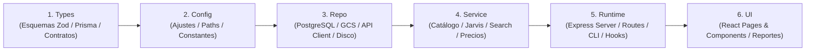
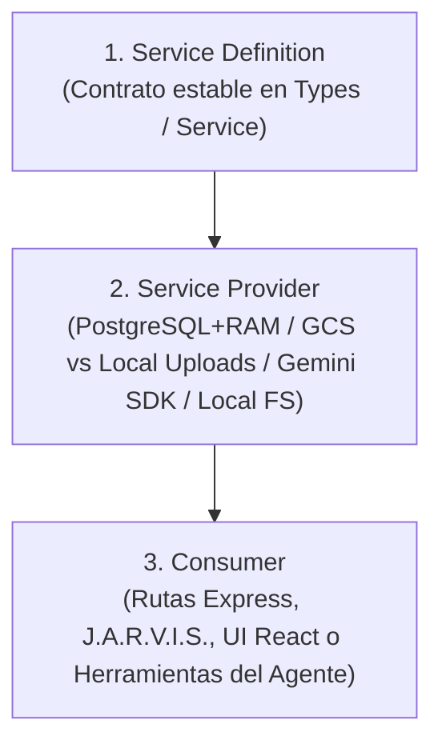

# ARCHITECTURE.md

Este documento es el mapa superior de **Deco Vintage Guate (`deco-vintage-web`)**. Mantiene una vista concisa de qué dominios existen en producción (`https://decovintage.online`), cómo se mapea la estructura *Brownfield* real del proyecto al modelo estricto de 6 capas, qué costuras de capacidad (`Capability Seams`) desacoplan la infraestructura y cómo se imponen mecánicamente las fronteras arquitectónicas.

## 1. Forma General del Sistema

- **Proyecto / Flujo de Trabajo:** Plataforma web e-commerce, catálogo interactivo de pósters decorativos en MDF de 5.5mm, cotizador de órdenes personalizadas (`#CP-XXXX`) y asistente multimodal IA **J.A.R.V.I.S.** de **Deco Vintage Guate**, gobernada por el Arnés Maestro de Ingeniería en 3 Puertas.
- **Flujo Principal del Sistema:** Recibe especificaciones secuenciales (`feature_list.json`, `WIP = 1`) y entrega incrementos full-stack ESM verificados a través de **3 Puertas en orden estricto** (Estática/Arquitectura -> Comportamiento `100/100` -> Sistema Completo: Secretos + Sintaxis + Modelos Gemini + 65 Pruebas + `vite build`), preservando la estabilidad del contenedor de producción (`Dockerfile` + `entrypoint.sh` sobre Dokploy/Hostinger VPS).
- **Superficies de Ejecución:**
  - **Producción (`Runtime` Web + API)**: Servidor Express 5 (`server.js`) con compresión, Helmet CSP, CORS estricto, inyección SSR dinámica de OpenGraph para `/poster/:id`, API REST (`/api/auth`, `/api/catalog`, `/api/settings`, `/api/custom-orders`, `/api/jarvis`), Prisma ORM 6 sobre PostgreSQL, motor de imágenes Sharp (`libvips42`) y SPA React 18 compilada con Vite 5 (`dist/`).
  - **Arnés y Gobernanza CLI**: Scripts POSIX (`init.sh`, `scripts/check-architecture.sh`), runners Node.js (`scripts/validate-harness.mjs`, `scripts/harness-hooks.mjs`) y compuertas Zero-Trust de Deko Labs (`scripts/audit-harness.js`, `scripts/audit-secrets.js`, `scripts/audit-syntax.js`, `scripts/verify-gemini-models.js`).
- **Fuente de Verdad del Comportamiento:** `feature_list.json`, `sprint-contract.md`, `ARCHITECTURE.md`, `PROJECT.md` (contratos API Fase 3) y `docs/product-specs/` (bajo demanda).

## 2. Mapa de Dominios

| Dominio (Área) | Propósito (De qué es dueño) | Carpeta / Punto de Entrada | Especificación Relacionada |
| :--- | :--- | :--- | :--- |
| **Aplicación / Producto (`app`: `catalog`, `custom-orders`, `jarvis`, `admin`, `seo`)** | Catálogo de obras, categorías normalizadas (`posters_categoria_fkey`), franquicias, órdenes personalizadas con cálculo autoritativo en servidor, asistente multimodal J.A.R.V.I.S. (RAG + búsqueda visual), SSR OpenGraph `/poster/:id` y panel administrativo WCAG 2.1 AA | Backend: `validators/`, `config/`, `prisma/`, `services/`, `routes/`, `middleware/`, `utils/`, `server.js` · Frontend: `src/config/`, `src/data/`, `src/utils/`, `src/pages/`, `src/components/`, `src/App.jsx`, `src/main.jsx` | `feature_list.json`, `sprint-contract.md`, `PROJECT.md` |
| **Gobernanza e Instrucciones (`instructions`)** | Índice operativo del agente (~100 líneas), Startup Workflow, escalado, reglas `WIP = 1`, prompts `Maker-Checker`, Skill bajo demanda, grafo de 5 nodos y mapa arquitectónico | `AGENTS.md`, `ARCHITECTURE.md`, `goal.md`, `maker-prompt.md`, `checker-prompt.md`, `.agents/skills/maker-checker/SKILL.md`, `graph.md` | `AGENTS.md` |
| **Estado, Alcance y Ciclo de Vida (`state`, `scope`, `lifecycle`)** | Estado secuencial de tareas (`not-started`, `in-progress`, `blocked`, `done`), contrato de sprint, estado entre rondas con Trinquete (*Ratchet*) y 4 disyuntores, evidencia ejecutable, progreso y entrega de turno | `feature_list.json`, `sprint-contract.md`, `loop-state.md`, `progress.md`, `session-handoff.md`, `clean-state-checklist.md` | `clean-state-checklist.md` |
| **Auto-Memoria Persistente (`memory`)** | Retención de directrices soberanas de negocio y contexto no derivable del código bajo el Invariante de Guardado en Dos Pasos, exclusión mutua y límite duro de 200 líneas / 25 KB | `memory/INDEX.md`, `memory/topics/harness-rules.md`, `memory/topics/deco-vintage-context.md` | `memory/INDEX.md` |
| **Verificación, Límites Mecánicos, Seguridad y Observabilidad Dual (`verification`)** | Higiene de repositorio, esquema JSON canónico, validación en 3 puertas, auditoría `100/100`, vigilante arquitectónico con Bolígrafo Rojo, escáneres Zero-Trust de secretos/sintaxis/modelos IA, suites `node:test`, hooks deterministas (`stdin`/`stdout` JSON + Candado 3 `one-shot`), logs JSON (`correlationId`), rúbrica Checker (`0-12`), semáforo (`A-D`) y 15 Gotchas | `.gitignore`, `.gitattributes`, `scripts/feature-list.schema.json`, `init.sh`, `scripts/check-architecture.sh`, `scripts/validate-harness.mjs`, `scripts/harness-hooks.mjs`, `scripts/lib/harness-utils.mjs`, `scripts/audit-*.js`, `scripts/verify-gemini-models.js`, `tests/`, `docs/RELIABILITY.md`, `docs/SECURITY.md`, `.agents/hooks.json`, `evaluator-rubric.md`, `docs/QUALITY_SCORE.md`, `docs/GOTCHAS.md` | `docs/GOTCHAS.md` |

## 3. Modelo Estricto de Capas (Flujo Direccional Único — Mapeo Brownfield)

Para evitar arquitectura *ad hoc* o regresiones cruzadas entre cliente y servidor, todo módulo nuevo o existente respeta la dirección única de 6 capas:

`Types (Definiciones) -> Config (Ajustes) -> Repo (Datos/Archivos) -> Service (Lógica de Negocio) -> Runtime (Ejecución) -> UI (Interfaz/Salida)`

### Ubicación de Componentes en las 6 Capas (Canónicas y Mapeo Brownfield Real)

| Capa | Responsabilidad | Mapeo Real en `deco-vintage-web` (y Ruta Canónica `src/`) | Artefactos del Arnés |
| :--- | :--- | :--- | :--- |
| **1. `Types`** | Contratos de datos, esquemas declarativos Zod, modelos/enums Prisma y clases de error sin lógica de capas superiores | `validators/adminSchemas.js`, `prisma/schema.prisma`, `utils/app-error.js` (y `src/types/` para nuevos contratos TS/ESM) | `scripts/feature-list.schema.json`, esquema de `feature_list.json`, `GraphState` en `graph.md` |
| **2. `Config`** | Variables de entorno validadas, rutas de volúmenes Docker, cliente base y constantes puras que solo dependen de `Types` | `config/paths.js`, `config/prisma.js`, `src/config/constants.js` (`src/config/`) | `.gitignore`, `AGENTS.md`, `ARCHITECTURE.md`, `docs/SECURITY.md`, `.agents/hooks.json`, `goal.md` |
| **3. `Repo`** | Acceso a PostgreSQL, Google Cloud Storage, sistema de archivos (`uploads/`), adaptadores HTTP cliente y almacenamiento local | `prisma/migrations/`, `services/gcsService.js`, `data/jarvisConfig.json`, `src/utils/apiClient.js`, `src/utils/catalogStorage.js`, `src/data/` (`src/repo/`) | Funciones I/O (`readText`, `readJson`, `writeText`, `loadHarnessFiles`) en `scripts/lib/harness-utils.mjs` |
| **4. `Service`** | Reglas puras de negocio: catálogo y caché RAM, cálculo autoritativo de órdenes, visión/RAG Gemini, compresión Sharp/WebP y motor de búsqueda | `services/catalogService.js`, `services/customOrderService.js`, `services/embeddingService.js`, `services/imageService.js`, `services/jarvisService.js`, `services/openGraphService.js`, `services/posterVisionService.js`, `src/utils/{searchEngine,jarvisBrain,posterHelpers,imageOptimizer,vcard}.js` (`src/service/`) | Funciones puras (`scoreHarness`, `validateFeatureListObject`) en `scripts/lib/harness-utils.mjs` |
| **5. `Runtime`** | Bootstrap de contenedor y servidor Express, middlewares, rutas HTTP, enrutador SPA y orquestadores CLI | `server.js`, `entrypoint.sh`, `Dockerfile`, `routes/*.js`, `middleware/*.js`, `src/main.jsx`, `src/utils/routes.js`, `scripts/audit-*.js`, `scripts/verify-gemini-models.js` (`src/runtime/`) | `init.sh`, `scripts/check-architecture.sh`, `scripts/validate-harness.mjs`, `scripts/harness-hooks.mjs` |
| **6. `UI`** | Vistas y componentes React 18 accesibles (WCAG 2.1 AA), modales y estilos que consumen `Service`/`Runtime` | `src/App.jsx`, `src/pages/*.jsx`, `src/components/**/*.jsx`, `src/index.css`, `index.html` (`src/ui/`) | Formateadores (`formatScoreReport`, `htmlReport`) en `scripts/lib/harness-utils.mjs` y salida Bolígrafo Rojo |

### Reglas Duras de Dependencia (Invariantes)

1. **Prohibido ir hacia atrás (`No Backward Dependencies`)**: Una capa inferior (`Types`, `Config`, `Repo`, `Service`) NUNCA puede depender ni importar de una capa superior (`Runtime`, `UI`), ni terminar el proceso directamente con `process.exit` dentro de librerías de dominio.
2. **Prohibido saltar capas (`No Layer Skipping`)**: La interfaz (`UI`) puede consumir contratos puros de `Types`, pero NUNCA debe evadir `Service` o `Runtime` para mutar directamente `Config` o `Repo` (reparar siempre discrepancias de datos en el servicio productor, nunca parchar consumidores UI con defaults silenciosos).
3. **Acceso a datos acotado y autoridad del servidor**: Toda persistencia pasa por Prisma/`catalogService.js` y todo cálculo financiero de pedidos (`calculateAuthoritativeOrderTotals`) se recalcula autoritativamente en el servidor ignorando montos del cliente.
4. **Justificación de dependencias nuevas**: Toda nueva dependencia NPM debe justificarse explícitamente en `sprint-contract.md` antes de modificar `package.json`, cuidando la compatibilidad de binarios nativos con `node:20-bookworm-slim` (`Dockerfile`).
5. **Preocupaciones transversales (`Cross-Cutting Concerns`)**: Entran únicamente por las fronteras explícitas de la sección 5 (`docs/RELIABILITY.md`, `docs/SECURITY.md`).
6. **Validación de Terminación en 3 Puertas (`3-Gate Verification`)**: Toda ejecución de `init.sh` supera en orden estricto Puerta 1 Estática (`bash scripts/check-architecture.sh`), Puerta 2 Comportamiento (`node scripts/validate-harness.mjs --min-score 100`) y Puerta 3 Sistema Completo (`npm run check` + `npm test` + `npm run build` -> `CLEAN STATE`).
7. **Invariante de Bolígrafo Rojo (`Red-Pen Error Format`)**: Todo error emitido por un script de verificación incluye `ERROR:` (qué falló y dónde), `POR QUÉ:` (qué invariante protege) y `SOLUCIÓN (FIX):` (acción exacta para repararlo).

## 4. Capability Seams (Costuras de Capacidad Intercambiables — DeepSeek Harness)

El proyecto desacopla sus integraciones críticas mediante **`Capability Seams`** de tres roles (`Service Definition -> Service Provider -> Consumer`):

- **Almacenamiento y Procesamiento de Medios**: `imageService.js` + `gcsService.js` abstraen la optimización Sharp WebP (`full` y `thumb`) entre Google Cloud Storage (`https://storage.googleapis.com`) y el volumen persistente local Docker (`/app/public/posters/uploads`).
- **IA Multimodal y Búsqueda Semántica (`@google/genai`)**: `jarvisService.js`, `posterVisionService.js` y `embeddingService.js` encapsulan los modelos vigentes de Google Gemini (auditados mecánicamente por `scripts/verify-gemini-models.js` contra modelos apagados).
- **Lectura de Catálogo con Caché RAM Coherente**: `catalogService.js` (`getCachedFullCatalog`, TTL 5 min con invalidación instantánea en mutaciones) desacopla la lectura de alta concurrencia en `/api/catalog` y `/api/jarvis/chat` respecto de PostgreSQL, mientras el cliente usa `apiClient.js` / `catalogStorage.js`.
- **Ejecución y Verificación del Arnés**: `scripts/lib/harness-utils.mjs` y `scripts/harness-hooks.mjs` desacoplan la lógica pura de validación respecto del entorno de ejecución (`Local FS`, `git worktree` o sub-agente aislado `one-shot`).

## 5. Interfaces Transversales (Cross-Cutting Interfaces)

| Preocupación | Límite / Adaptador Aprobado | Notas e Invariantes |
| :--- | :--- | :--- |
| **Logging, errores y trazabilidad** | `middleware/errorHandler.js`, `utils/app-error.js` y esquema `RuntimeLogEntry` de `docs/RELIABILITY.md` | Envoltorio API dual `{ success, data, ...legacy }` en 200/201 y `{ success: false, error, details? }` en 400/500; logs estructurados con `correlationId` y cero secretos/PII. |
| **Autenticación Zero-Trust y secretos** | `middleware/auth.js` (HMAC `ADMIN_SECRET` fail-fast), `scripts/audit-secrets.js` y `docs/SECURITY.md` | El servidor aborta en producción si falta `ADMIN_SECRET`; cero bypasses de desarrollo (`x-dev-role`); `.env*` y `google-service-account*.json` bloqueados en Git y en `PreToolUse`. |
| **APIs externas, IA y subidas** | `services/posterVisionService.js`, `services/gcsService.js`, `middleware/rateLimit.js` y `middleware/validate.js` | Visión remota confinada por HTTPS a `storage.googleapis.com` (anti-SSRF); rutas locales confinadas a `public/posters/uploads` (anti-traversal); validación Zod declarativa y rate-limiting en login/IA. |
| **Directrices soberanas de dominio** | `memory/topics/deco-vintage-context.md` y validadores en `services/` y `tests/` | Prohibido autogenerar con IA el campo `posters.tags` (uso exclusivo para apodos internos manuales de taller); flujo de seguimiento de taller pausado hasta integrar contrato API con `Modulo_Ventas`. |

## 6. Puntos Calientes Actuales (Current Hotspots)

Zonas del repositorio donde cualquier cambio exige máxima cautela para proteger la estabilidad en producción:

- **`Dockerfile`, `entrypoint.sh` y `server.js`**: Gobiernan el despliegue en producción sobre `node:20-bookworm-slim` con `libvips42` (Sharp), `npx prisma migrate deploy` *fail-fast* (prohibido silenciar errores con `||`), SSR dinámico OpenGraph en `GET /poster/:id` antes del fallback SPA y límites granulares de payload (`50mb` admin, `8mb` `/api/jarvis/chat`, `1mb` global).
- **`services/catalogService.js`, `src/utils/catalogStorage.js` y `routes/settingsRoutes.js`**: Persistir ajustes o categorías vía `POST /api/settings/save` con `posters: []` desacoplado (nunca re-subir ni re-indexar las ~546 obras al guardar settings, ni sobrescribir `_cachedPosters` con arreglos base vacíos en `resetCatalogToDefault`).
- **Nota de Migración Brownfield (`UI -> Config` en `src/config/constants.js`)**: Actualmente `CartDrawer.jsx`, `JarvisAgent.jsx` y `CustomPostersPage.jsx` viven en `src/components/` y `src/pages/` e importan `generateWhatsAppLink` desde `src/config/constants.js`. Si en el futuro esos componentes se mueven físicamente a `src/ui/`, debe extraerse primero `generateWhatsAppLink` hacia `src/service/` para cumplir la Regla Dura #2 de `scripts/check-architecture.sh`.
- **`init.sh`, `scripts/check-architecture.sh`, `scripts/lib/harness-utils.mjs`, `.agents/hooks.json` y `scripts/harness-hooks.mjs`**: Ejecutan las 3 Puertas deterministas (`set -euo pipefail`), el puntaje `100/100` y los candados nativos `PreToolUse` (incluyendo bloqueo de `prisma migrate reset` / `--force-reset` / `--accept-data-loss`), `PostToolUse` y `Stop`.

## 7. Lista de Verificación al Modificar la Arquitectura

Cuando modifiques código o reglas relevantes para la arquitectura:

1. Actualiza este archivo (`ARCHITECTURE.md`) si el mapa de dominios, el mapeo Brownfield de 6 capas, los `Capability Seams` o las interfaces transversales cambiaron.
2. Registra el razonamiento arquitectónico y las alternativas descartadas (`Alternatives considered`) en `progress.md` y, cuando exista `docs/design-docs/`, actualiza el documento de diseño correspondiente.
3. Agrega o actualiza una verificación ejecutable en `scripts/check-architecture.sh` o `tests/` si la nueva regla debe imponerse mecánicamente.
