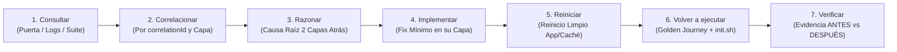

# RELIABILITY.md (Observabilidad de Runtime, Fiabilidad en 3 Puertas y Validación UI)

Este documento define cómo **Deco Vintage Guate (`deco-vintage-web`)** demuestra de forma determinista que está saludable, es observable desde señales locales y permanece reiniciable (`restartable`), eliminando las suposiciones y los reintentos a ciegas (*blind retries*) tanto en el backend Express/Prisma como en la SPA React.

---

## 1. Las 4 Rutas Estándar y Señales Requeridas en Tiempo de Ejecución

Todo trabajo en este repositorio expone cuatro rutas operativas canónicas que cualquier sesión nueva puede ejecutar sin configuración manual:

| Ruta Estándar | Comando / Procedimiento Canónico | Propósito Operativo |
| :--- | :--- | :--- |
| **1. Arranque (`Startup`)** | `bash ./init.sh` (en PowerShell: `& "C:\Program Files\Git\bin\bash.exe" ./init.sh`) | Confirma directorio, integridad de artefactos críticos, cliente Prisma/dependencias y salud de línea base antes de tocar código. |
| **2. Verificación (`Verification`)** | `bash ./init.sh` (`check-architecture.sh` + `validate-harness.mjs` + `npm run check` + `npm test` + `npm run build`) | Ejecuta secuencialmente las 3 Puertas (Estática, Comportamiento `100/100` y Sistema Completo: Secretos, Sintaxis, Modelos IA, 65 Tests y Build Vite). |
| **3. Iniciar aplicación o servicio (`Start app / service`)** | `RUN_START_COMMAND=1 bash ./init.sh` (Frontend dev: `npm run dev`; Servidor full-stack: `npm start`) | Levanta la aplicación únicamente después de haber superado las 3 puertas de verificación previas. |
| **4. Depurar o inspeccionar runtime (`Debug / inspect runtime`)** | Filtrado local de trazas JSON por `correlationId` / `level: "error"` + `GET /api/health` / `GET /api/version` + suite aislada `node --test tests/<suite>.test.js` | Permite diagnosticar la causa raíz y la capa propietaria del fallo desde señales locales antes de modificar código. |

### Señales Requeridas en Tiempo de Ejecución (`Required Runtime Signals`)
Está estrictamente prohibido emitir mensajes vagos como `"Algo salió mal"` o silenciar fallos en bloques `catch {}` vacíos. El runtime debe proporcionar cuatro señales observables:
1. **Logs estructurados** para el arranque y los flujos críticos de mutación/IA (siguiendo `RuntimeLogEntry` en nuevos módulos e instrumentaciones).
2. **Verificaciones de salud (`health checks`)** para el servidor Express (`/api/health`, `/api/version`), conexión PostgreSQL/Prisma y estado de caché en memoria (`getCachedFullCatalog`).
3. **Datos de traza o tiempo (`durationMs`, latencia de Gemini/GCS y estado de caché)** para rutas multimodales (`/api/jarvis/chat`, visión de pósters y carga de catálogo).
4. **Estados de error visibles, tipados y accionables** bajo el envoltorio estándar `{ success: false, error, details? }` (con secretos, tokens HMAC y PII redactados según `docs/SECURITY.md`).

---

## 2. Esquema Obligatorio de Logs JSON Estructurados (`RuntimeLogEntry`)

Cada paso crítico de observabilidad en módulos nuevos o refactorizados de runtime/automatización debe registrar un **objeto JSON estructurado** con estos 8 campos obligatorios:

| Campo | Tipo | Obligatorio | Descripción y Propósito |
| :--- | :--- | :--- | :--- |
| `timestamp` | `string` (ISO 8601) | Sí | Fecha y hora exacta en UTC (ej. `"2026-11-18T19:10:00.000Z"`). |
| `level` | `"info" \| "warn" \| "error"` | Sí | Nivel de severidad del evento. |
| `component` | `string` | Sí | Módulo del sistema que emite el evento (ej. `"CatalogService"`, `"JarvisService"`, `"CustomOrderService"`, `"HarnessValidator"`). |
| `action` | `string` | Sí | Operación específica en curso (ej. `"hidratar_cache_catalogo"`, `"calcular_totales_orden"`, `"evaluar_5_subsistemas"`). |
| `durationMs` | `number` | Sí | Tiempo de ejecución en milisegundos para detectar cuellos de botella y regresiones de latencia. |
| `input` | `object \| string` | Sí | Resumen sanitizado de los parámetros de entrada (sin `ADMIN_SECRET`, `GEMINI_API_KEY` ni imágenes base64 crudas). |
| `output` / `error` | `object \| null` | Sí | Resultado estructurado en caso de éxito (`output`) o detalle exacto del fallo (`error` con `message`, `why` y `fix`). |
| `correlationId` | `string` | Sí | Identificador único por solicitud o corrida (ej. `"req-8f2a1c"`) para rastrear una operación a través de las 6 capas. |

### Ejemplo Canónico: Evento Exitoso (`level: "info"`)

```json
{
  "timestamp": "2026-11-18T19:15:04.120Z",
  "level": "info",
  "component": "CustomOrderService",
  "action": "crear_orden_personalizada",
  "durationMs": 34,
  "input": {
    "itemsCount": 2,
    "hasCustomerNotes": true
  },
  "output": {
    "orderNumber": "CP-1042",
    "authoritativeTotalQ": 290,
    "status": "PENDIENTE"
  },
  "error": null,
  "correlationId": "req-8f2a1c"
}
```

### Ejemplo Canónico: Evento de Fallo con Bolígrafo Rojo (`level: "error"`)

```json
{
  "timestamp": "2026-11-18T19:15:05.305Z",
  "level": "error",
  "component": "PosterVisionService",
  "action": "resolver_imagen_remota",
  "durationMs": 4,
  "input": {
    "imageUrlHost": "untrusted-host.example"
  },
  "output": null,
  "error": {
    "message": "Host remoto no autorizado en resolveImageInlineData.",
    "why": "docs/SECURITY.md confina la lectura remota de imágenes exclusivamente a HTTPS sobre storage.googleapis.com para bloquear SSRF.",
    "fix": "Sube primero la imagen al bucket oficial o al directorio local public/posters/uploads antes de solicitar autocompletado visual."
  },
  "correlationId": "req-8f2a1c"
}
```

---

## 3. Contrato de Fiabilidad en 3 Puertas (`init.sh`) y Recorridos Dorados (`Golden Journeys`)

Ningún cambio en `deco-vintage-web` se considera fiable hasta superar secuencialmente las **3 Puertas de Verificación** ejecutadas por `bash ./init.sh` bajo modo estricto POSIX (`set -euo pipefail`):

1. **Puerta 1 — Estática y Límites Arquitectónicos (`Static & Architecture Gate`)**:
   - Comprueba la existencia física de los artefactos vitales del arnés y ejecuta `bash scripts/check-architecture.sh` para validar `ARCHITECTURE.md`, las 6 capas (`Types -> Config -> Repo -> Service -> Runtime -> UI`), los límites de Auto-Memoria (`memory/INDEX.md <= 200` líneas / `25 KB` e Invariante de Dos Pasos), cero enlaces muertos en `Required Artifacts`, formato de `.agents/hooks.json` y el escáner `cleanup-scanner`.
2. **Puerta 2 — Comportamiento y Reglas de Subsistemas (`Behavioral Gate`)**:
   - Ejecuta `node scripts/validate-harness.mjs --min-score 100` exigiendo `100/100` (`25/25 PASS`) en los 5 subsistemas (`instructions`, `state`, `verification`, `scope`, `lifecycle`), validando `WIP <= 1`, orden secuencial DAG y `Pass-State Gating`.
3. **Puerta 3 — Sistema Completo de Deco Vintage Guate (`End-to-End System Gate`)**:
   - Verifica `node_modules` y cliente Prisma generado, ejecuta `npm run check` (`audit-secrets.js` + `audit-syntax.js` + `verify-gemini-models.js`), `npm test` (65 pruebas automatizadas en 10 suites cubriendo seguridad Zero-Trust, higiene de contenedor, motor de búsqueda, visión IA, caché RAM, contratos frontend, deep-links OpenGraph y búsqueda visual J.A.R.V.I.S.) y `npm run build` (`vite build`), confirmando `CLEAN STATE`.

### Recorridos Dorados (`Golden Journeys`)

| ID | Recorrido Dorado (`Golden Journey`) | Ruta de Verificación Repetible | Señal de Éxito Esperada | Señal Clara de Fallo |
| :--- | :--- | :--- | :--- | :--- |
| **`GJ-01`** | **Arranque en frío y salud integral en 3 puertas** | `bash ./init.sh` | Código `0`, `Overall: 100/100` (`25/25 PASS`), `65/65 tests PASS`, `vite build` limpio y cierre `CLEAN STATE`. | Parada inmediata (`Exit != 0`) con bloque `ERROR + POR QUÉ + SOLUCIÓN`. |
| **`GJ-02`** | **Transición de tarea bajo `WIP = 1`, DAG y `Pass-State Gating`** | `node scripts/validate-harness.mjs --min-score 100` + `bash scripts/check-architecture.sh` | Máximo 1 tarea `in-progress`, dependencias en `done`, `required_files` con tamaño `> 0` y `evidence` real al cerrar. | Caída de puntaje `< 100/100` o fallo `fl_check` en Puerta 1. |
| **`GJ-03`** | **Entrega limpia y reinicio entre sesiones (`Clean Handoff`)** | Revisión de `progress.md` + `session-handoff.md` + `bash ./init.sh` | Cero temporales (`*.tmp`, `*.swp`, capturas sueltas en raíz) y marcadores de reinicio completos. | Alerta de `cleanup-scanner` o `tests/repo-hygiene.test.js`. |
| **`GJ-APP-01`** | **Catálogo público, búsqueda progresiva multi-token y Deep-Link OpenGraph `/poster/:id`** | `node --test tests/searchEngine.test.js tests/deeplink-opengraph-catalog.test.js` | Prefijos cortos precisos (`"Harry P"`, `"Por"` -> `"Porsche"`), caché RAM activa (`Cache-Control` público) y etiquetas `og:title`/`og:image` escapadas contra XSS en `/poster/:id`. | Falsos positivos entre categorías, caché no invalidada tras mutación o XSS/fallback roto en `/poster/:id`. |
| **`GJ-APP-02`** | **Carrito, cotización autoritativa `#CP-XXXX` y puente WhatsApp** | `node --test tests/backend-security-catalog.test.js tests/frontend-contracts.test.js` | Servidor recalcula precios (`calculateAuthoritativeOrderTotals`), emite código `#CP-XXXX`, `CartDrawer.jsx` adjunta el código al enlace de WhatsApp y limpia el carrito. | Precios manipulados por cliente aceptados, falta de `#CP-XXXX` en mensaje o ReferenceError en panel admin. |
| **`GJ-APP-03`** | **Asistente J.A.R.V.I.S. (memoria protegida + búsqueda visual multimodal)** | `node --test tests/jarvis-memory-cache.test.js tests/jarvis-visual-search.test.js` | `ownerDirectives` intactas ante purgas de eventos vencidos, compresión cliente JPEG <= 1024px y respuesta multimodal combinando obras similares + opción personalizada MDF 5.5mm. | Purga accidental de directivas del dueño, payload `> 8mb` rechazado o modelos Gemini obsoletos. |

---

## 4. Bucle de Depuración de Observabilidad en 7 Pasos (`SOP observability-feedback-loop`)

Cuando ocurre un fallo en tiempo de ejecución o el comportamiento real diverge del esperado, sigue estrictamente este bucle de **7 pasos**:



1. **Consultar (`query`)**: Inspeccionar la salida real de la puerta o test fallido, logs estructurados y tiempos.
2. **Correlacionar (`correlate`)**: Seguir el flujo desde la ruta/UI hasta el servicio productor (`correlationId` / cadena de llamadas).
3. **Razonar (`reason`)**: Identificar qué capa (`Types -> Config -> Repo -> Service -> Runtime -> UI`) originó el defecto (aplicando la regla de reparar en el servicio productor, nunca enmascarar en la UI).
4. **Implementar (`implement`)**: Aplicar la corrección mínima en la capa responsable respetando `WIP = 1`.
5. **Reiniciar (`restart`)**: Reiniciar limpiamente el proceso Express/Vite o invalidar la caché en memoria para descartar estado residual.
6. **Volver a ejecutar (`re-run`)**: Correr el Recorrido Dorado afectado y `bash ./init.sh`.
7. **Verificar (`verify`)**: Confirmar con evidencia ejecutable que el fallo desapareció sin regresiones.

**Invariantes Permanentes de Fiabilidad:**
- **Fallo Rápido (`Fail-Fast`) y Cero Reintentos a Ciegas**: Tanto `entrypoint.sh` (`npx prisma migrate deploy` bajo `set -e`) como `init.sh` (`set -euo pipefail`) fallan de inmediato ante errores reales; prohibido silenciarlos con `|| true`.
- **Reiniciabilidad obligatoria**: Ninguna tarea está completa si el repositorio no vuelve a pasar `bash ./init.sh` en frío.
- **Barrera ante fallos repetidos**: Todo bug corregido en producción se promueve a prueba automatizada en `tests/` o regla en `scripts/check-architecture.sh`.

---

## 5. Validación de UI / Frontend y Bucle con Chrome DevTools

En la interfaz React de Deco Vintage Guate (`src/pages/`, `src/components/`), la inspección estática del código es insuficiente. Todo cambio visual o interactivo debe cumplir estas barreras:

### Principios de UI, Accesibilidad WCAG 2.1 AA y los 5 Estados Visibles Clave
- **Cero `window.confirm` nativos y accesibilidad real (`WCAG 2.1 AA`)**: Usar siempre `<ConfirmDialog>` (`role="alertdialog"`, `aria-modal="true"`, foco gestionado y cierre con `Escape`), etiquetas `<label htmlFor>` vinculadas y soporte completo de teclado (`Space`/`Enter` en controles interactivos).
- **Cobertura obligatoria de los 5 estados visibles**:
  1. **`vacío` (`empty`)**: Mensaje claro cuando una búsqueda o categoría no arroja pósters o el carrito está vacío.
  2. **`cargando` (`loading`)**: Indicadores visuales inmediatos y bloqueo de doble envío (`isLoading`) al subir obras, consultar a J.A.R.V.I.S. o confirmar pedidos.
  3. **`éxito` (`success`)**: Actualización reactiva inmediata del catálogo/carrito y confirmación visual clara.
  4. **`error` (`error`)**: Mensajes legibles y sanitizados ante errores de red o validación HTTP 400/429/500 (prohibidos los `catch` silenciosos o `ReferenceError` ocultos).
  5. **`reintento` (`retry`)**: Posibilidad directa de corregir y reintentar sin perder los datos ingresados en el formulario o carrito.

### Bucle Principal de Validación con Chrome DevTools MCP (8 Pasos `ANTES / DESPUÉS`)
Tanto en entorno local (`http://localhost:5173` / `http://localhost:3000`) como en verificación post-despliegue en vivo (`https://decovintage.online` con recarga limpia de caché):

1. **Seleccionar la página objetivo** en Chrome DevTools MCP.
2. **Limpiar mensajes obsoletos de consola** antes de interactuar.
3. **Capturar el estado `ANTES`** (snapshot de accesibilidad/DOM, captura visual y red).
4. **Disparar exactamente una ruta de UI** a la vez (búsqueda progresiva, filtro de categoría/franquicia, modal `/poster/:id`, carrito o chat J.A.R.V.I.S.).
5. **Observar eventos en tiempo real** (consola sin errores React, respuestas HTTP `200/201` con contrato dual y cabeceras `Cache-Control`).
6. **Capturar el estado `DESPUÉS`** (redactando cualquier token de sesión admin o PII, y guardando capturas fuera de la raíz del repo para respetar `tests/repo-hygiene.test.js`).
7. **Corregir en la capa responsable más pequeña** y reiniciar si aplica.
8. **Re-ejecutar hasta cumplir los 4 criterios de limpieza**: estado visible correcto, cero errores inesperados, consola limpia y repetibilidad determinista.
